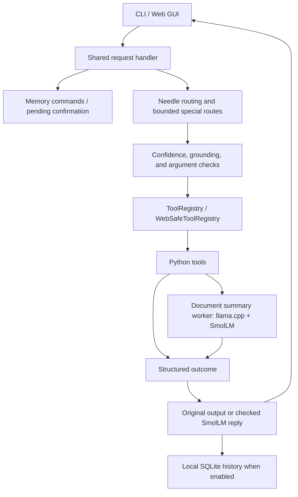

# Arsitektur EmberOS

[Kembali ke README](../README.md) · [Panduan review](REVIEW_GUIDE.md)

## Alur utama

Diagram merangkum jalur utama; penolakan validasi dan kasus unsupported dapat
berakhir tanpa eksekusi. Worker model hanya dipakai ketika jalur membutuhkannya.

## Peta tanggung jawab

| Komponen | Peran |
| --- | --- |
| [`run_ember.py`](../run_ember.py) | CLI, shared handler, konteks file, pemilihan kandidat, dan konfirmasi aksi |
| [`web_ember.py`](../web_ember.py) | UI/HTTP, sesi bertoken, allowlist dan konfirmasi tool web |
| [`needle_router.py`](../needle_router.py) | Skema Needle, pemilihan tool, pemeriksaan confidence/grounding, dan multi-step terbatas |
| [`emberos/tools.py`](../emberos/tools.py) | Registry, validasi argumen, eksekusi implementasi, dan hasil tool |
| [`use_cases/`](../use_cases/) | Implementasi file, sistem, tasks, dokumen, media, dan integrasi opsional |
| [`use_cases/local_llm.py`](../use_cases/local_llm.py) | Worker llama.cpp, token budgeting, ringkasan, dan penghentian worker |
| [`emberos/replies.py`](../emberos/replies.py) | Balasan singkat berdasarkan hasil tool; kembali ke respons asli jika generasi tidak valid |
| [`emberos/memory.py`](../emberos/memory.py) | History SQLite dan pencarian literal yang dibatasi |
| [`emberos/undo.py`](../emberos/undo.py) | Satu slot undo dan pemeriksaan keadaan target |
| [`emberos/config.py`](../emberos/config.py) | Lokasi data/log, termasuk override `EMBER_DATA_DIR` |

Fungsi `@needle.tool` yang berisi `pass` di router adalah **deklarasi skema**.
Implementasi eksekusi berada di registry/use cases. Nama, parameter, dan default
harus konsisten saat menambah tool.

## Router dan model teks memiliki tugas berbeda

Needle memilih aksi dan argumen. Ada pula jalur khusus yang dibatasi, termasuk
listing folder umum dan selector history/konteks. Karena itu, hasil satu prompt
yang ditangani langsung tidak membuktikan akurasi inferensi Needle.

SmolLM digunakan untuk ringkasan dan balasan singkat tertentu setelah eksekusi.
Model tidak dilatih ulang. Secara default, worker berhenti setelah job.
Manifest model dan checksum disimpan di [`models/manifest.json`](../models/manifest.json).

`smollm_fallback.py` mengembalikan pesan tetap; nama route `fallback_llm` tidak
berarti bahwa model benar-benar dijalankan. Ringkasan ekstraktif juga harus
dibedakan dari keluaran generatif saat evaluasi.

## State dan platform

History percakapan, notes/tasks, log, state konfirmasi, dan slot undo memiliki
peran berbeda. Menghapus history tidak menghapus seluruh state aplikasi.
Detail penyimpanan ada di [panduan memory](CONVERSATION_MEMORY.md).

Companion membuka akses ke backend melalui discovery dan SSH. Tool berjalan
pada host backend; membuka GUI di Windows tidak membuat file Windows tersedia
di Pi. Adapter desktop memerlukan OS, dependensi, dan sesi desktop yang sesuai.
